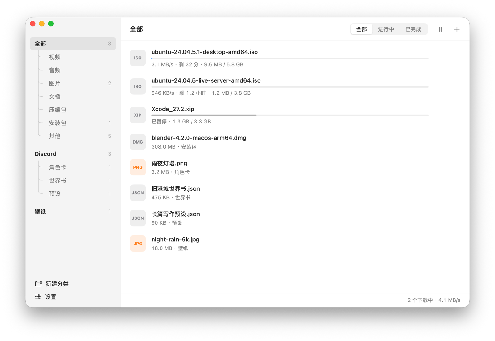

<p align="center">
  
</p>

<h1 align="center">拾雨</h1>

<p align="center">
  一个安静好用的 macOS 下载器：分段加速、断点续传、自动归类，还能接管浏览器下载。
</p>

<p align="center">
  <a href="https://github.com/git-yafaya/RainKeep/releases/latest"></a>
  
  <a href="LICENSE"></a>
</p>

<p align="center">
  简体中文 · <a href="README_en.md">English</a>
</p>

<p align="center">
  
</p>

## 特点

- **快**：服务器支持时多线程分段下载；先下完的线程会自动分担剩余最长的分段，所有线程始终跑满
- **稳**：暂停、断网、重启后都从断点续传，网络出错自动重试
- **会整理**：按类型存入「下载」中的子文件夹；支持自定义分类并学习你的归类习惯，即使同为 JSON 的世界书和预设也能区分
- **接管浏览器**：在 Chrome、Edge、Arc、Brave 中点击下载，会直接交给拾雨
- **好看**：外观支持跟随系统及三套内置主题，可自定义背景图；支持中英文界面

## 安装

1. 到 [Releases](https://github.com/git-yafaya/RainKeep/releases/latest) 下载 `Rainkeep-<版本>.dmg`
2. 打开后把「拾雨」拖进「应用程序」
3. 首次打开若被系统拦截（应用暂未经过 Apple 公证），请前往「系统设置 → 隐私与安全性」点击「仍要打开」

## 使用

- ⌘N 或工具栏 `+`：粘贴链接（每行一个），⌘Enter 开始；也可以把链接直接拖进窗口
- 鼠标移到任务上：暂停、继续、重试、移除
- 侧栏底部「新建分类」，右键分类可建子分类（最多三级）；把任务拖到分类上即可归类。同类文件手动归过两三次，之后就会自动归类
- 菜单栏图标随时显示下载进度；开启后关闭窗口，下载仍会继续
- ⌘,：设置（下载位置、同时下载数、主题、字号、背景图、语言等）
- 设置 →「更新检测」→ 检查更新：检测到「新雨已至」时，点「接住新雨」即可直接下载新版安装包

## 接管浏览器下载

1. 设置 → 接管浏览器下载 → 接管：拾雨会把扩展放进「下载」文件夹，并打开访达和浏览器扩展页
2. 在扩展页右上角打开「开发者模式」，把「拾雨扩展」整个拖进去
3. 设置中显示「已连接」即代表成功。请勿删除「下载」文件夹中的「拾雨扩展」，浏览器运行时需要从中加载

想了解扩展怎么工作、连不上怎么排查，见 [扩展说明](browser/chrome/README.md)。

## 从源码构建

需要 macOS 14+ 和 Xcode。

```bash
./scripts/make-app.sh && open .build/Rainkeep.app   # 调试版 App
./scripts/make-dmg.sh                                # release 版 DMG，产物在 dist/
DEVELOPER_DIR=/Applications/Xcode.app/Contents/Developer swift test
```

代码结构：

- [下载引擎与分类逻辑](Sources/RainkeepCore)：不依赖界面，`swift test` 测的就是它
- [界面](Sources/Rainkeep)：SwiftUI
- [浏览器宿主](Sources/RainkeepHost) 和 [扩展](browser/chrome)：接管浏览器下载
- [界面原型](prototype/index.html) 和 [界面规则](docs/UI.md)：改界面先看这两个

## 许可证

[MIT](LICENSE) © 2026 yafaya
