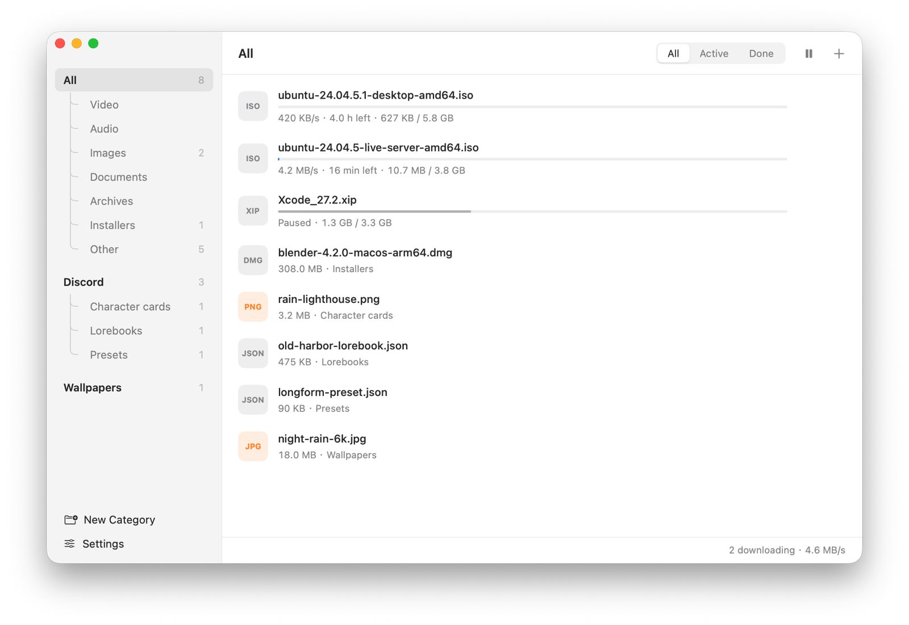

<p align="center">
  
</p>

<h1 align="center">Rainkeep</h1>

<p align="center">
  A macOS download manager: segmented downloads, resume, auto-sorting and browser takeover.
</p>

<p align="center">
  <a href="https://github.com/git-yafaya/RainKeep/releases/latest"></a>
  
  <a href="LICENSE"></a>
</p>

<p align="center">
  <a href="README.md">简体中文</a> · English
</p>

<p align="center">
  
</p>

## Features

- **Multi-connection**: segmented downloads when the server allows it; a connection that finishes early takes over half of the largest remaining segment
- **Resume**: picks up after pausing, network loss or restart; retries network errors automatically
- **Auto-sorting**: files go into subfolders of Downloads by type; custom categories learn your habits and can tell apart lorebooks and presets that are both JSON
- **Browser takeover**: downloads in Chrome, Edge, Arc and Brave go straight to Rainkeep
- **Themes**: follows the system appearance, plus three built-in themes and a custom background image; Chinese and English UI

## Install

1. Download `Rainkeep-<version>.dmg` from [Releases](https://github.com/git-yafaya/RainKeep/releases/latest)
2. Open it and drag Rainkeep into Applications
3. macOS blocks the first launch because the app isn't notarized: click "Open Anyway" in System Settings → Privacy & Security

## Usage

- ⌘N or the toolbar `+`: paste links (one per line), ⌘Enter to start; or drag links onto the window
- Hover a task to pause, resume, retry or remove it
- "New Category" at the bottom of the sidebar; right-click a category to add subcategories (up to three levels); drag tasks onto a category. After about three manual moves, similar files are sorted automatically
- The menu bar icon shows progress; while it's on, closing the window keeps downloads running
- ⌘,: Settings (download folder, concurrent downloads, theme, text size, background, language and more)
- Settings → Updates → Check for Updates: when a new version is out, "Catch the Rain" downloads its installer with Rainkeep itself

## Browser takeover

1. Settings → Take over browser downloads → Connect: Rainkeep puts the extension in your Downloads folder and opens Finder and the browser's extensions page
2. Turn on "Developer mode" at the top right of that page and drag "Rainkeep Extension" in as a whole
3. Settings shows "Connected to <browser>" when it works. Keep "Rainkeep Extension" where it is; the browser loads the extension from there

How the extension works and how to troubleshoot it: [extension notes](browser/chrome/README.md) (in Chinese).

## Build from source

Needs macOS 14+ and Xcode.

```bash
./scripts/make-app.sh && open .build/Rainkeep.app   # debug app
./scripts/make-dmg.sh                                # release DMG in dist/
DEVELOPER_DIR=/Applications/Xcode.app/Contents/Developer swift test
```

Code layout:

- [Download engine and sorting logic](Sources/RainkeepCore): no UI code; this is what `swift test` covers
- [UI](Sources/Rainkeep): SwiftUI
- [Browser host](Sources/RainkeepHost) and [extension](browser/chrome): browser takeover
- [UI prototype](prototype/index.html) and [UI rules](docs/UI.md) (in Chinese): read these before changing the UI

## License

[MIT](LICENSE) © 2026 yafaya
